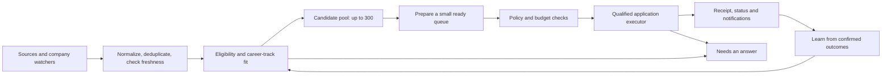

# Pursuit: the job-hunting product contract

Discussion draft, 2026-10-22. This records product decisions and an implementation proposal, not capabilities already delivered. Source findings and references: [job-hunting research](research/job-hunting-pipeline.md). Current native behavior: [career workspace](CAREER_WORKSPACE.md).

Implementation update, 2026-10-23: global discovery is the chosen direction. The first [headless sourcing engine and retained API importer](DISCOVERY_ENGINE.md) now exist, including source snapshots, bounded polling and evidence ranking. Desktop integration and production coverage remain unfinished. The model-spend ceiling is still undecided.

## Decisions confirmed in this discussion

- Prioritize broad coverage while enforcing eligibility and daily limits.
- The requested personal application ceiling is **100 per day**. It is a ceiling, not a guaranteed output or a quota to fill with weak applications.
- Plan an **optional always-on worker** for execution while the desktop is unavailable. Local execution remains available. Hosting, synchronization and remote authorization are new work. **User-hosted first; managed hosting later** is confirmed.
- Preserve bounded automatic applications after explicit setup; outreach needs exact-message approval.
- Discovery scope is **global / any country**. This does not imply global work authorization: applications must respect each role’s residence, timezone, employment and visa requirements against confirmed user facts.
- Main harness implementation waits for agreement on the pipeline. Landing improvements can proceed independently.

Still undecided: model token/spend budget; first geography/work-authorization and career tracks; first mobile distribution channel. No hosting price, inference cost or source coverage promise has been approved.

## Recommendation: a replenishing pipeline

Separate discovery, qualification, preparation and execution into durable queues. Run discovery periodically, not an unconstrained model/browser loop. An initial sweep builds a useful pool; useful applications can start before the pool reaches 300. Keep a maximum of 300 live candidate roles in the active pool as a proposed configurable limit; retain compact deduplication/submission history separately. Do not count closed, excluded or duplicate records as new opportunities.

Proposed preparation work-in-progress: 10–20 roles, replenished as applications progress, rather than preparing all 300. These defaults need measurement. Before preparation and immediately before submission, recheck the listing, career facts, exclusions, grant and budget. Urgent user-selected roles and newly opened watched-company roles can move ahead in the queue without bypassing eligibility.

A scheduler remains available; jobs execute only when due and within budgets. Unchanged checks sleep. Model calls stop when no useful queued work exists. Pausing application execution need not stop cheap discovery; the interface must expose separate controls.

## Where intelligence belongs

| Stage                 | Default mechanism                                                                      | Model use                                                            |
| --------------------- | -------------------------------------------------------------------------------------- | -------------------------------------------------------------------- |
| Source planning       | Role taxonomy, title aliases, locations, exclusions, company/ATS directory             | Optional bounded query expansion when a search profile changes       |
| Fetch and watch       | Typed APIs, permitted feeds/pages, conditional requests, change hashes, backoff        | None for unchanged or structured sources                             |
| Normalize/deduplicate | Provider IDs, canonical URLs, content hashes and cautious duplicate suggestions        | Only ambiguous extraction/identity cases if allowed                  |
| Eligibility           | Confirmed facts and explicit hard requirements                                         | Explain ambiguous requirements; never invent answers                 |
| Fit ranking           | Transparent weighted rules; optional local semantic retrieval                          | Limited job/profile evaluation with evidence and unknowns            |
| Resume/letter         | Reusable career-track baseline, selected evidence, deterministic document rendering    | Grounded edits for the selected role, cached by input revisions      |
| Application           | Qualified ATS form adapters, saved confirmed answers, deterministic uploads/validation | Unfamiliar questions or page layout as a bounded fallback            |
| Receipt/tracking      | Confirmation reference, URL, evidence and immutable event                              | Optional classification; success never inferred just from model text |
| Counts/status         | Database queries and event summaries                                                   | None required for routine counts                                     |

Non-model work is model-token-free, not infrastructure-free. Network/search APIs, CPU, browser sessions, local models and remote workers still have costs. BYOM pays for chosen inference and inherits provider limits. Avoid sending full browser HTML/screenshots or entire career history every turn. Cache evaluation by job content, confirmed-profile revision, rubric and model; invalidate when any relevant input changes. Cache preparation by approved facts, posting version and writing preferences. Reuse facts and templates, never one generic resume blindly across unrelated jobs.

Broad discovery combines typed company ATS adapters, user watchers, a maintained source directory and optionally a licensed search/index provider. Search finds canonical employer links; ATS adapters verify them. A crawler alone cannot understand fit. A model alone cannot make every source accessible. Start with measured coverage for engineering, QA, design and analytical roles; keep role-family schemas separate and extensible for other careers. Explicit required licenses, education or work rights remain hard requirements regardless of profession.

“Active” means observed on the authoritative board at a shown time; it cannot prove an employer is interviewing. Indeed, LinkedIn and Glassdoor coverage must use permitted access, not an assumption that public pages authorize bulk automation. Do not bypass access challenges or promise every job board. Keep publication, first-seen, last-seen and last-checked dates distinct.

## Applications: 100/day without losing control

Maintain independent limits for source requests, model tokens/calls, browser attempts, submissions, concurrency and estimated spend. Reserve capacity atomically before an action so multiple workers cannot each spend the same remaining budget. Count failures against attempt budgets; release a submission reservation only when evidence permits. Provider usage reports reconcile estimated spend; unknown prices remain visibly unknown, with token/request limits still enforced.

Give each application an idempotency identity based on person + canonical employer role. Keep a state machine: discovered → eligible/needs-answer/excluded → selected → preparing → ready → authorized → submitting → confirmed/uncertain/failed/closed. Never automatically retry an uncertain submission: reconcile the receipt or ask the user first. An “Applied” claim needs confirmation evidence, not a click event.

A grant scopes role families, countries, work mode, salary constraints, sources, exclusions, daily caps, validity and which material changes may proceed automatically. Policy revisions revoke outstanding authorizations. A grant is checked against the exact prepared payload; it is not broad permission to improvise missing personal answers. Questions about sponsorship, criminal history, legal attestations, salary commitments or absent evidence can block the job. Employer requests for video, a test or an account become a task with a clear next action. Cold outreach remains separately approved per message.

One hundred unique applications may require hours of browser execution, sufficient eligible openings and source-specific limits. Do not promise that every day reaches 100, run 100 browser tabs, or evade rate limits. Start executor qualification on a narrow supported path; expand only after reliable receipts, retries, uploads, failure recovery and policy behavior are demonstrated.

## Harness: conversation plus an inspectable operation

The assistant is a natural-language control surface over typed operations, not a model improvising every action. “How many applications today?” queries the store. “Find remote QA roles above my salary floor” proposes a search-profile change; after confirmation, a scheduler executes it. Important changes have a visible structured preview.

| Surface            | User sees and does                                                                                                                    |
| ------------------ | ------------------------------------------------------------------------------------------------------------------------------------- |
| Today / assistant  | Activity since last visit, applied/ready/needs-you counts, next scheduled check, remaining budgets, chat and global pause             |
| Search plan        | Career tracks, skills with evidence, hard constraints, preferences, title aliases, scope and automatic-application grant              |
| Opportunities      | Deduplicated candidates, source/freshness, fit reasons, missing evidence; prioritize, exclude or inspect                              |
| Sources & watchers | Follow a company URL, supported adapter, interval, last successful check, health, changes and notification policy                     |
| Applications       | Ready, in progress, confirmed, uncertain and needs-you; per-job timeline and receipt                                                  |
| Documents          | Original resume, career-track baseline, job-specific version, highlighted grounded edits, cover letter, export and version provenance |
| Outreach           | Company → sourced contact with evidence → draft → exact review → approved send → reply history                                        |
| Tasks              | Video/script/checklist, assessments, missing facts and account actions; open the relevant role/document directly                      |
| Activity & budgets | Queued/running work, source failures, next retries, token estimates, worker host, daily limits and pause/resume                       |
| Connections        | Models, Gmail direct/Composio, worker authorization, paired devices and revocation                                                    |

Keep domain views within the current conversational shell. Background progress is structured and persistent, not simulated typing or a chat message for every fetch. Notify immediately for decisions/blockers/security changes; aggregate routine sourcing and completion into useful digests. Every notification deep-links to its role, prepared material and next action. Outcome feedback can adjust search preferences through an explained revision; no hidden model retraining or automatic relaxation of hard constraints.

## Desktop, worker and phone

Two execution hosts share a logical workspace but only one worker may own an action lease. A relay transports encrypted commands; it never substitutes for execution. Offline commands are queued with expiry and revalidated when a worker reconnects. Event versions and payload hashes prevent stale approvals; revocation must be acknowledged by the executor. Do not synchronize live SQLite files between hosts.

- **Local:** the desktop worker must be awake, running and online. A future tray/background mode can survive closing a window, but not power-off. Current desktop closes its runtime on quit.
- **Optional remote worker:** a user-authorized always-on host holds its own scoped secrets and approved career data. It can execute while the laptop is off; remote execution and mobile review are independent features. Choose user-hosted and/or managed delivery before building deployment/billing. Local-only Ollama is not reachable when its computer is off; a remote worker needs its own reachable, authorized model connection.
- **Phone:** an authenticated companion for reviews, approvals, pause, budgets and notifications. Pair device keys with an expiring QR challenge and confirmation; no required Pursuit account. Accountless does not mean unauthenticated. Separate an installation QR/link from the pairing QR. Never encode model keys, long-lived bearer secrets or the full resume in a QR.

Recommend an installable web companion to validate pairing/approvals first, then native iOS and Android releases. The user has not selected that channel yet. Native beta options are TestFlight and Play testing; a production store listing requires release work and review. A desktop download is not a phone-app install, Expo Go is not production distribution, and a landing mockup is not a shipping companion. Publish real store/install links only when available. Push payloads should be minimal; fetch protected content after authentication.

## Build order and acceptance gates

1. Lock search profile, schemas, budgets and policy semantics. Confirm target countries and fact requirements.
2. Implement desktop discovery queue + first structured sources + watchers, persisted freshness and dedup. Demonstrate useful cross-career results without inference for unchanged checks.
3. Add bounded fit evaluation and grounded material versions with real export. Measure cost per useful candidate and prepared application.
4. Qualify one application executor end to end: authorized payload, upload, confirmation, uncertain result, restart and duplicate suppression. Add daily caps; expand source/form coverage gradually.
5. Implement worker leases/event sync, scoped remote secrets and deployment; prove pause/revoke and no duplicate submissions across hosts.
6. Add accountless companion pairing, decisions, offline queue and delivery; distribute beta/PWA only after real device verification.

Evaluate relevance, eligibility mistakes, coverage/freshness, duplicate rate, grounded-document errors, confirmed submission rate, uncertain outcomes, time-to-first-useful-application and token/compute cost. Volume alone is not the quality score. None of these proposed executor/worker/companion stages is declared complete by this document.
