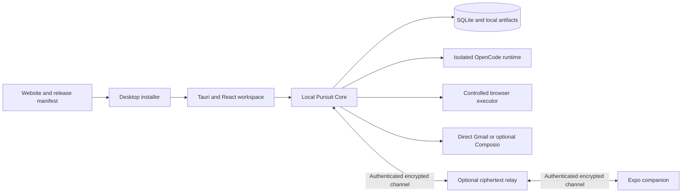

# Pursuit desktop-first implementation plan

Date: **2026-10-22**. Status: researched implementation plan; application code has not been migrated in this planning pass. Amend the existing product rather than starting over.

## Product decisions and precedence

| Decision              | Resolution                                                                                                                                                                                                                                    |
| --------------------- | --------------------------------------------------------------------------------------------------------------------------------------------------------------------------------------------------------------------------------------------- |
| Delivery              | Local-first desktop harness; website distributes it; no separate hosted career dashboard.                                                                                                                                                     |
| First alpha platforms | macOS, Windows and Linux together. Proposed minimum artifact matrix: macOS Apple Silicon + Intel, Windows x64, Linux x64 AppImage + Debian. Additional architectures/packages require their own qualification.                                |
| Application autonomy  | Default Assisted; user may explicitly enable a bounded automatic-application policy. It remains revocable and does not authorize outreach.                                                                                                    |
| Outreach authority    | Exact-message/destination approval before every send, including follow-ups.                                                                                                                                                                   |
| Connect               | Optional accountless encrypted internet relay; desktop remains authoritative and must be running.                                                                                                                                             |
| Models                | User-owned connections. OpenCode runtime/configuration and OpenCode-hosted inference are separate supported integration goals. Ollama is a first-alpha local-model target, subject to capability qualification.                               |
| Visual identity       | Preserve Pursuit's mark, Geist typography, white/black/neutral foundation and useful existing components. Evolve into an agent workspace, not a hosted-dashboard wrapper.                                                                     |
| Showcase              | Keep one dominant hero capture/play control, respecting the earlier rejection of multiple hero tabs. Put deeper workflow exploration below it; do not reintroduce six hero tabs merely because the supplied structural reference listed them. |

The explicit autonomy answer supersedes older per-application approval wording, including the supplied directives, for opted-in supported applications only. It does not change current executable policy in this planning pass. Signed policy enforcement must precede enabling automatic submission.

## Recommendation

**Tauri 2 + React/Vite desktop renderer, TypeScript Pursuit Core, Core-owned SQLite, isolated Playwright browser execution, managed OpenCode runtime, and an optional ciphertext relay.** Tauri is a candidate with an early cross-platform proof gate, not a claim that it is already qualified. Electron is the fallback if a named packaging or runtime requirement fails. See [research](research/desktop-core-connect.md).

Keep Next.js for the website. Reuse domain/UI packages and useful screen logic. Extract current Nest services rather than porting every workflow to Rust. Desktop frontend cannot rely on a Next server, Docker, external Postgres/Redis or installed developer tools.

Relay has no provider credentials or application-execution authority. Model providers and Gmail are external services the user explicitly connects; “no Pursuit account” does not remove their accounts/billing/consent.

## Proposed repository boundaries

| Path                            | Responsibility / reuse                                                                                                       |
| ------------------------------- | ---------------------------------------------------------------------------------------------------------------------------- |
| `apps/desktop`                  | Tauri host, static React shell, native commands, lifecycle, tray and updates. Reuse UI and domain contracts.                 |
| `apps/core`                     | Supervised local TypeScript host; authenticated IPC/loopback boundary; task scheduling, subscriptions and local services.    |
| `packages/core`                 | Career Identity, tasks, writing, applications, authority and repository interfaces extracted from API services.              |
| `packages/local-store`          | SQLite repositories, migrations, artifacts, event/action ledger, backup/export/import. Decide driver after packaging spike.  |
| `packages/agent-core`           | Evolve existing runtime adapter, event contracts and policy gateway; no unrestricted coding tools.                           |
| `packages/sources`              | Public feed/URL/social-input adapters and normalized snapshots/provenance.                                                   |
| `packages/browser`              | Browser profiles, inspection, typed actions, ATS adapters and confirmation reconciliation.                                   |
| `packages/resume`               | Parsing, normalized resume structure, deterministic templates, PDF/DOCX generation and validation.                           |
| `packages/connect`              | Pairing/channel protocol, device capability checks, command/event schemas and sync tests.                                    |
| `apps/relay`                    | Optional constrained encrypted transport service; no career database/dashboard.                                              |
| `apps/mobile`                   | Existing Expo companion, pairing, offline snapshots, tasks, approvals and notifications.                                     |
| `apps/web`                      | Existing public site; honest prerelease/download manifest, docs links and real product captures.                             |
| `apps/api`, `packages/database` | Retain during migration as compatibility fixtures/import source; retire production dependence only after replacement parity. |

These are seams, not a requirement to generate empty packages immediately. Introduce each with a real consumer and test.

## First useful vertical slice

**Import or create resume → confirm Career Identity → choose writing preferences → connect OpenCode/provider → paste supported job URL → preserve source → research company → evaluate eligibility → tailor resume → produce a cover letter and answer packet → review preflight → save evidence and resume versions.**

The first public alpha is useful on all three OS families without claiming universal auto-apply. Browser submission, bounded automatic mode and remote approvals each have additional release gates. Do not make first-alpha completion depend on every later feature.

## Phases and exit gates

### P0 — Architecture and cross-platform risk proof

- [x] Read directives, audit current modules, research primary sources, capture user decisions.
- [x] Preserve PRD and append an explicit desktop/autonomy amendment.
- [ ] Pin candidate Tauri/Core/OpenCode/browser versions and redistribution licenses/checksums.
- [ ] Build and install a minimal local shell that starts/stops Core, opens SQLite and launches an isolated OpenCode/browser on macOS ARM/Intel, Windows x64 and Linux x64.
- [ ] Compare embedded OpenCode SDK vs supervised sidecar. Prove auth, credential boundaries, model inventory, events, interruption and process cleanup.
- [ ] Choose SQLite driver by migration, native packaging and transaction tests; prove crash/restart recovery.
- [ ] Prove OS credential storage, locked-store behavior and backup/restore.

**Exit:** fresh machines need no Node/Rust/Docker/OpenCode development install; process tree and network listeners are documented; failures are diagnosable. Reject a framework choice with evidence before proceeding if this fails. Core starts under a per-install trust secret, not a public unauthenticated port.

### P1 — Career Identity, onboarding and personal writing

- [ ] Extend current profile into typed personal/contact, work/project, education, skills, location/authorization/sponsorship, availability, target-role and compensation records.
- [ ] Introduce immutable `CareerFact` revisions with source/evidence, confirmed/imported/inferred/unknown/contradictory/outdated state, timestamps and confirmation history. User-confirmed facts outrank extraction; contradictions remain explicit.
- [ ] Import PDF/DOCX and retain originals; scanned/image-only content enters an explicit OCR/manual-review path. Support blank/manual identity creation.
- [ ] Eight progressive onboarding steps from the directive; optional integrations and skip/explore paths.
- [ ] Writing Identity stores tone/length/punctuation/pattern rules and approved/rejected examples. Style samples do not become evidence of qualifications.
- [ ] Build fact-scoped context selection, sentence/claim provenance, deterministic style checks and a bounded research → angle → draft → critique → revise pipeline. Learn persistent preferences only when the user accepts them.
- [ ] Resume structure, immutable versions, original/proposed comparison, one reliable ATS-oriented template, PDF/DOCX export and text/order/layout validation. Expand to six templates after the same content pipeline passes.

**Exit:** first slice works end to end with confirmed facts, no unsupported qualifications, consistent writing rules, valid documents and restart persistence. No complete Career Identity dump to providers when a smaller fact set suffices.

### P2 — Working agent harness and OpenCode connections

- [ ] Three-region shell: compact/resizable sidebar, structured task workspace/composer, collapsible/resizable Browser/Evidence/Files/Approvals/Logs inspector; persist sizes.
- [ ] Command palette, keyboard navigation, model chooser, task search, notifications and local/runtime status.
- [ ] Real task/session/step streaming and durable runtime session IDs. Separate user-visible plan/status summaries from private model reasoning.
- [ ] Implement actual cancellation, pause-at-safe-boundary, retry classification and checkpoint recovery. Preserve evidence and failed steps.
- [ ] Model connections: existing OpenCode provider config (selective import), direct APIs, OpenCode hosted inference/Zen and Ollama. Add general OpenRouter/Groq after integration checks; Hermes remains a model-family label within a provider.
- [ ] Never reuse arbitrary coding-agent hooks, shell permissions or project files. All tools route through typed Pursuit capabilities and executor-owned authority.

**Exit:** a real source task streams through an isolated runtime, stops correctly, resumes after restart and cannot escape tool scope. A compatibility matrix distinguishes inventory, text inference, structured output, vision and tool orchestration. No Go compatibility promise without provider workload confirmation.

P1 and the P2 shell/runtime foundation can overlap after P0; the combined first useful slice is the **all-platform Alpha 1** gate.

### P3 — Discovery, company research and application intelligence

- [ ] Split current Greenhouse importer into adapter + normalized job evidence. Add Ashby and Lever public feeds.
- [ ] URL/text ingestion follows the authoritative careers link, captures date/source and checks open/closed state. Screenshot/PDF/mobile share inputs preserve provenance. Inaccessible social pages fall back to supplied text or manual takeover.
- [ ] Rebuild eligibility around jurisdiction, residence, sponsorship, relocation, degree required/preferred, experience intervals, language and certifications. Unknown never becomes a yes; “remote” never establishes worldwide eligibility.
- [ ] Typed question resolver returns known/confirm/missing/ambiguous/ineligible/unsupported/manual outcomes. High-impact and voluntary demographic facts are never inferred.
- [ ] Company research records source/date and factual vs speculative context. Select relevant verified user experiences for writing.
- [ ] Discovery table/detail inspector and list/board application pipeline; preserve existing application history through explicit state mappings.

**Exit:** the directive's 20 intelligence cases pass; stale/contradictory sources and prompt injection pause or fail clearly. Public feed access is not mistaken for permission to call an employer's submission API. [Greenhouse](https://docs.greenhouse.io/job-board), [Ashby](https://developers.ashbyhq.com/docs/public-job-posting-api), [Lever](https://github.com/lever/postings-api).

### P4 — Controlled browser applications and bounded auto-apply

- [ ] Controlled persistent profiles with explicit login setup; browser inspection/manual takeover. Do not inherit the user's personal browser cookies.
- [ ] Owned ATS fixtures for Greenhouse, Ashby and Lever first; then qualify live supported forms. Workday, SmartRecruiters, iCIMS and generic fallback follow as separate compatibility milestones, not a universal-support claim.
- [ ] Analyze/fill/upload/validate; manual approval mode binds exact payload and artifacts.
- [ ] Add versioned application-policy grants and executor-generated one-use action tickets, as specified below. No automatic mode until enforcement tests pass.
- [ ] Recheck source, authority, content, budgets and required facts immediately before submit. Verify actual confirmation and store evidence.
- [ ] Reconcile uncertain results before retry; manual action for CAPTCHA/MFA/legal attestations/unsupported controls/missing facts.

**Exit:** crash-at-submit, timeout, stale form, changed policy, revoked device and duplicate-worker tests do not create duplicate applications. A real controlled end-to-end demo has a receipt; “clicked submit” is not success. **Alpha 2** can enable bounded automation only for the tested adapter/source matrix.

### P5 — Outreach and first-class Writing Studio

- [ ] Company/people research, published professional contact provenance, speculation labels, no guessed-as-verified addresses.
- [ ] Recipient context/editor/evidence/preferences layout; version comparison, angle explanation and factual/style validators.
- [ ] Direct installed-app Gmail OAuth + optional Composio; Gmail drafts with actual IDs, exact-message sending approval, reply association and reconciliation.
- [ ] Suppression lists, prior-contact dedupe, preparation/send limits and follow-up review.
- [ ] LinkedIn/X begin as supported ingestion plus draft/manual handoff. Authorized sending is a separately qualified integration.

**Exit:** distinct researched drafts, genuine Gmail draft IDs and user edits retained; no outreach send or follow-up occurs under an application-only policy. **Alpha 3** includes qualified outreach.

### P6 — Standing goals and briefings

- [ ] Migrate current schedules/leases into durable goal-driven jobs with scope, expiry, quiet hours, daily/rolling limits, usage reservation, backoff and dead-letter/manual recovery.
- [ ] Truthful daily briefing from stored new/deduplicated results and outstanding actions; no repeated questions about confirmed facts.
- [ ] Sleep/wake catch-up is bounded, with clear unavailable/paused/error states. Closing a window, quitting the process and sleeping the computer have different documented effects.

**Exit:** controlled overnight/restart tests preserve budget and action accounting; no noisy notification storm after wake.

### P7 — Pursuit Connect and mobile

- [ ] Threat-model accountless pairing and encrypted outbound relay transport; choose a reviewed protocol implementation, not homegrown crypto.
- [ ] Device enrollment/confirmation, scopes, revocation, rotation, replay resistance, event sequence cursor and snapshot fallback.
- [ ] Expo pairing, task views, evidence/drafts, exact-version approvals, application/outreach tracking and remote task composer.
- [ ] Generic push with explicit channel consent and necessary Apple/Google credentials; no sensitive lock-screen payloads.
- [ ] Test two mobile devices, offline queues, reordered messages, relay restarts and compromised/revoked sessions.

**Exit:** a paired phone on a different network approves an exact draft; desktop executes once. Desktop off remains unavailable. Relay cannot decrypt career data, authorize actions or run tasks. This is the **connected beta** gate.

### P8 — Distribution and website alignment (starts at P0)

- [ ] Per-OS CI build/test/install matrix from the first implementation milestone.
- [ ] Real signed/notarized release pipeline where credentials exist; unsigned development builds labeled honestly. Updater artifacts must be signed and version/rollback compatibility tested.
- [ ] Release manifest includes version/channel/OS/architecture/package URL/size/checksum/notes/signing status. OS detection recommends a choice; manual selection is always available.
- [ ] Website removes hosted Login/Sign up/Dashboard CTAs; Download leads to valid artifacts or an honest prerelease state, never a fabricated URL.
- [ ] Hero highlights supported provider identities and model access choices; captures actual desktop alpha states. Show Connect as planned until its gate passes.
- [ ] Replace old web-media tour only after a recorded real desktop workflow exists. Do not present design previews or fixture automation as live production capability.

**Exit:** clean-machine install, first-run identity/model setup and a useful task on every required OS; documented uninstall/update/data retention; real release URLs. Production-readiness claims require measured evidence.

## State and authority contracts

Keep task state distinct from application business stage and side-effect attempt state:

- Task: queued/planning/running/waiting_information/waiting_approval/paused/completed/failed/cancelled.
- Application business stage: discovered/saved/researching/preparing/awaiting_approval/submitted/interviewing/offer/rejected/archived, with explicit mapping from legacy values.
- Attempt: preflight/authorized/submitting/verified/uncertain/failed/manual_required. Unknown submission state locks replay.

Minimum new records: `CareerFactRevision`, `EvidenceArtifact`, `WritingIdentityVersion`, `Task`, `TaskStep`, `TaskCheckpoint`, `ToolExecution`, `ActionAttempt`, `ApplicationPolicyGrant`, `ActionAuthorization`, `UsageReservation`, `StandingGoal`, `DeviceIdentity`, `SyncEvent`, and `DocumentVersion`. Introduce tables with the slice that consumes them rather than speculative unused schema.

### Bounded automatic application authority

A user-created grant defines workspace, policy version/expiry, allowed sources/adapters, role/geography/compensation/exclusions, confirmed fact revision constraints, permitted documents/answer categories, per-run/day counts, token/cost/time bounds and stop conditions. Default off. Model output cannot widen it. Changing policy or facts invalidates incompatible pending authorizations.

Immediately before an application effect, Core atomically validates the grant, reserves capacity and creates an exact-payload one-use ticket bound to destination, job, draft/form version, resume/attachment hashes and attempt ID. The executor consumes it and records confirmation or uncertainty. Manual approval is the alternative authority source using the same payload binding. Outreach uses manual exact-message authority only. A generic client boolean such as `approvedTool: true` is never sufficient.

Use bounded conservative token reservations where price is unknown; do not claim an enforced monetary cap from a simple count of successful drafts. Failed requests/attempts also consume their applicable limits. Reset boundaries use an explicit user timezone and durable ledger.

## Test and evidence strategy

| Layer             | Required evidence                                                                                                                                                                                      |
| ----------------- | ------------------------------------------------------------------------------------------------------------------------------------------------------------------------------------------------------ |
| Domain            | Fact confirmation/contradiction, jurisdiction eligibility, required-vs-preferred degree, experience overlap, writing rules, source dedupe, answer outcomes and state mapping.                          |
| Storage/Core      | SQLite migrations and import parity, transactions, one-writer/lease contention, backup/restore, restart checkpoints and artifact integrity.                                                            |
| Runtime           | Pinned OpenCode inventory/inference/tool events, interrupted generation/tool, unavailable provider, reconnect, full model IDs and hostile tool requests.                                               |
| Documents         | PDF text extraction, DOCX round trip, reading order, font/page overflow, factual diffs and immutable submitted versions.                                                                               |
| Browser           | Synthetic ATS fixtures: conditional fields, uploads, auth expiry, MFA/CAPTCHA, validation, changed forms and crash/timeout at submission. No real applications during automated CI.                    |
| Autonomy/security | Policy narrowing/revocation, budget races, payload mutation, injection, path traversal, local endpoint access, restricted files, secret/log leakage, duplicate action and uncertain reconciliation.    |
| Connect/mobile    | MITM/replay/reordering, stale approval, device revocation, two-device races, relay offline, missed events, real iOS/Android reconnect and push builds.                                                 |
| UX/performance    | Keyboard/screen reader/reduced motion, desktop 1024×700 and 1440×900, mobile device sizes; startup/idle memory/list/event performance measured on named hardware. Set final budgets after P0 baseline. |
| Release           | Install/run/update/uninstall on clean macOS ARM/Intel, Windows x64 and Linux x64; sidecar/browser integrity, supported webview dependencies and signed update verification.                            |

Do not reuse the earlier 34 API passing tests as evidence for new desktop, browser or relay capabilities. They remain the regression baseline for retained code. Live-provider/ATS checks need isolated test accounts, explicit test scope and receipts; release docs identify mocked vs live evidence.

## Immediate implementation backlog

1. Create architecture proof harness and CI OS matrix; qualify Tauri + Core + SQLite + OpenCode + browser lifecycle.
2. Introduce repository/runtime/secret-store interfaces around reusable current services.
3. Build Career Identity provenance and progressive onboarding with import confirmation.
4. Make the first grounded writing/document packet work in the desktop shell.
5. Add runtime streaming/tools and supported source/answer preflight.
6. Qualify one browser adapter through manual review; then enforce bounded automatic policy.
7. Add real Gmail drafts/outreach and the optional Connect/mobile path.

No calendar estimate is asserted before P0 packaging/runtime results and maintainer capacity are known. Track each phase by passing exit evidence rather than optimistic dates. Signing accounts, OAuth publishing, model entitlements, relay hosting and mobile push credentials are provisioning dependencies, not reasons to invent functionality.

## Research and assessment

- [Change-impact assessment](DESKTOP_CHANGE_IMPACT.md)
- [Competitive analysis](research/competitive-analysis.md)
- [OpenCode runtime and hosted model support](research/opencode-runtime-and-models.md)
- [Desktop, local Core, Gmail and Connect architecture](research/desktop-core-connect.md)

## Foundation implementation update (2026-10-22)

The initial D0 shell uses a native Rust Core as the sole SQLite owner, avoiding a Node sidecar for basic persistence. Supervised OpenCode integration remains an explicit future boundary. See [current build status](DESKTOP_BUILD_STATUS.md); D0 packaging qualification is not complete.
